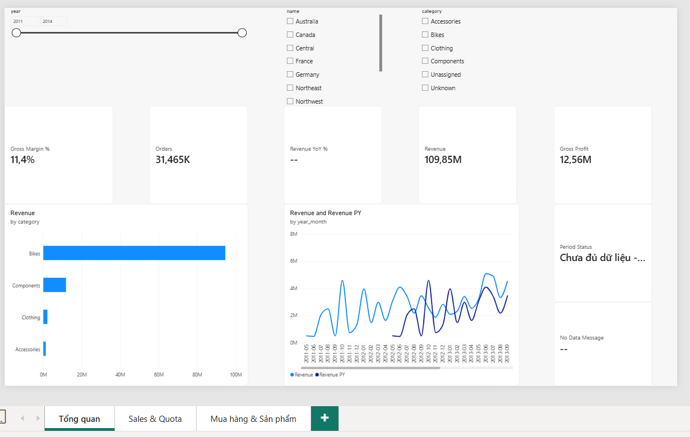
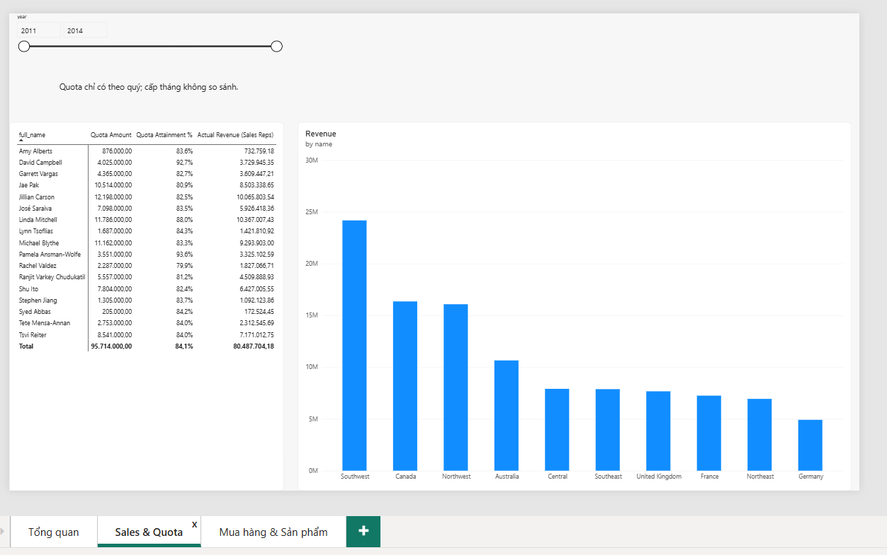
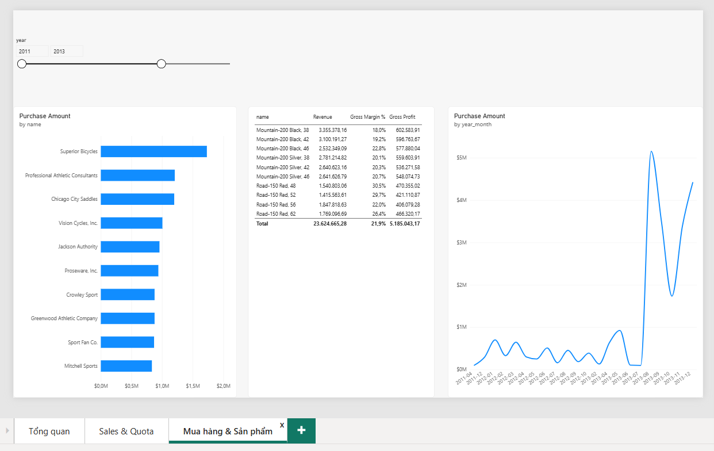
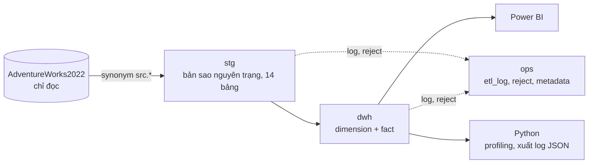
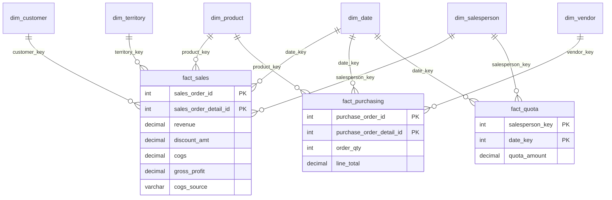

# Finance DWH + Power BI Dashboard

Kho dữ liệu tài chính (SQL Server) và dashboard Power BI xây từ cơ sở dữ liệu mẫu **AdventureWorks2022 (OLTP)**.
Đồ án portfolio cho vị trí Data Analyst / Data Engineer thực tập: ETL phòng thủ bằng T-SQL, star schema, DAX, kiểm thử tự động.

## Kết quả chính
- ETL `src → stg → dwh` chạy bằng **1 lệnh**: `EXEC ops.usp_run_etl;` (**~3 giây**, 121.317 dòng chi tiết bán hàng).
- Star schema: **6 dimension + 3 fact**, 10 khóa ngoại, không quan hệ nhiều-nhiều, không quan hệ hai chiều.
- **21 measure DAX** (Revenue, COGS, Gross Margin %, YoY, YTD/MTD, Quota Attainment…), đối chiếu 10 chỉ tiêu với SQL: khớp 100%.
- Dashboard **3 trang**: Tổng quan · Sales & Quota · Mua hàng & Sản phẩm.
- **34 test T-SQL + 68 test pytest + 4 test DAX + 4 test dashboard**, tất cả đạt.

## Dashboard
| Tổng quan | Sales & Quota | Mua hàng & Sản phẩm |
|---|---|---|
|  |  |  |

## Kiến trúc


## Mô hình dữ liệu (ERD)

Grain: `fact_sales` và `fact_purchasing` là **một dòng chi tiết đơn hàng**; `fact_quota` là **nhân viên × quý**.

## Thiết kế ETL phòng thủ
- Mỗi proc nạp chạy trong **một transaction** (`SET XACT_ABORT ON`, `TRY/CATCH`); lỗi giữa chừng thì **rollback toàn bộ**, dữ liệu cũ nguyên vẹn.
- Log từng bước vào `ops.etl_log` (SUCCESS / FAILED / ROLLED_BACK) kể cả khi rollback.
- Dòng sai bị **từ chối kèm lý do** vào `ops.reject` thay vì làm hỏng cả lần chạy.
- Chạy lại nhiều lần cho cùng kết quả (idempotent); khóa surrogate ổn định (SCD1, upsert, không xóa).
- Có hàng **Unknown (key = −1)** cho khóa thiếu hợp lệ (ví dụ đơn online không có nhân viên bán).
- Đối chiếu tự động `ops.usp_reconcile`: số dòng src = stg, dimension = stg, fact + reject = stg, doanh thu fact = tổng LineTotal.
- Kiểm tra siêu dữ liệu nguồn (bảng/cột thiếu → báo lỗi rõ ràng trước khi nạp).

## Quy ước nghiệp vụ
- **Revenue** = `LineTotal` (chưa gồm thuế và phí vận chuyển). **Discount** = số lượng × đơn giá − Revenue.
- **COGS** = số lượng × giá vốn trong `ProductCostHistory` tại ngày đặt hàng (nếu không có lịch sử thì dùng `StandardCost`; cột `cogs_source` ghi `HISTORY` hoặc `FALLBACK`).
- **Gross Profit** = Revenue − COGS.
- **Kỳ chưa đủ dữ liệu**: dữ liệu bán hàng chạy từ 2011-05 đến 2014-06, nên 2011 và 2014 chưa đủ năm. Measure `Revenue YoY %` chỉ hiện khi **cả kỳ hiện tại và kỳ năm trước đều đủ**; `Period Status` ghi nhãn rõ.
- **Quota** chỉ có theo quý. Quota gắn vào ngày đầu quý. Chỉ so sánh Quota vs Actual ở cấp quý/năm.

## Lưu ý về dữ liệu nguồn
- Một số quota 2014 rất nhỏ (ví dụ 1.000) nên Attainment hiển thị hàng nghìn %. Đó là dữ liệu gốc của AdventureWorks.
- Mua hàng tăng vọt từ giữa 2013 cũng là đặc điểm của dữ liệu mẫu.

## Hướng dẫn chạy từ đầu
Yêu cầu: Windows, SQL Server 2022+ (Developer/Express), SSMS, Power BI Desktop, Python 3.10+.

1. **Tải** `AdventureWorks2022.bak` (OLTP) từ trang Microsoft Learn "AdventureWorks sample databases". Chép vào thư mục Backup mặc định của instance (SQL Server cần quyền đọc).
2. **SSMS**, chạy theo thứ tự:
   1. `sql/01_restore.sql` (sửa `@bak_path` ở dòng 13 cho đúng đường dẫn).
   2. `sql/02_schemas_ops.sql`
   3. `sql/03_stg.sql`, `sql/04_dim.sql`, `sql/05_fact.sql`, `sql/06_etl_procs.sql`
3. **Nạp dữ liệu:** `USE FinanceDW; EXEC ops.usp_run_etl;` rồi `EXEC ops.usp_reconcile;` (tất cả dòng PASS).
4. **Kiểm thử SQL** (tùy chọn): chạy lần lượt `tests/test_module1.sql` … `test_module4.sql`, kết quả cuối bảng là `passed/failed`.
5. **Python:**
   ```
   pip install -r python/requirements.txt
   copy config.example.json config.json     (sửa "server" cho đúng máy)
   python -m pytest tests -q
   python python/profiling.py
   python python/export_etl_log.py --runs 5
   ```
6. **Power BI:** làm theo [docs/powerbi_guide.md](docs/powerbi_guide.md) (query ở `powerbi/queries.m`, measure ở `powerbi/measures.dax`), hoặc mở `powerbi/FinanceDW_public.pbix` rồi **Transform data → Edit parameters** để nhập `ServerName`, `DatabaseName`.
7. **Đối chiếu DAX:** `tests/dax_reference.sql` cho số liệu đúng theo năm.

## Cấu trúc thư mục
```
sql/        01..06: restore, schema + ops, staging, dimension, fact, proc chạy 1 lệnh + đối chiếu
tests/      test T-SQL theo module, pytest cho Python, dax_reference.sql
python/     profiling, xuất log JSON, kiểm tra config, kết nối
schemas/    JSON Schema cho dq_report.json và etl_log.json
powerbi/    queries.m, measures.dax, file .pbix
docs/       hướng dẫn Power BI, ảnh dashboard
```

## Bảo mật
Không lưu mật khẩu hay chuỗi kết nối trong repo. `config.json` nằm trong `.gitignore` và schema cấm trường `password`. Với SQL authentication, dùng biến môi trường `DW_USER`, `DW_PASSWORD`.

## Công nghệ
SQL Server (T-SQL, transaction, synonym, dynamic SQL) · Power BI (Power Query M, DAX, star schema) · Python (pandas, pyodbc, jsonschema, pytest) · Mermaid.
